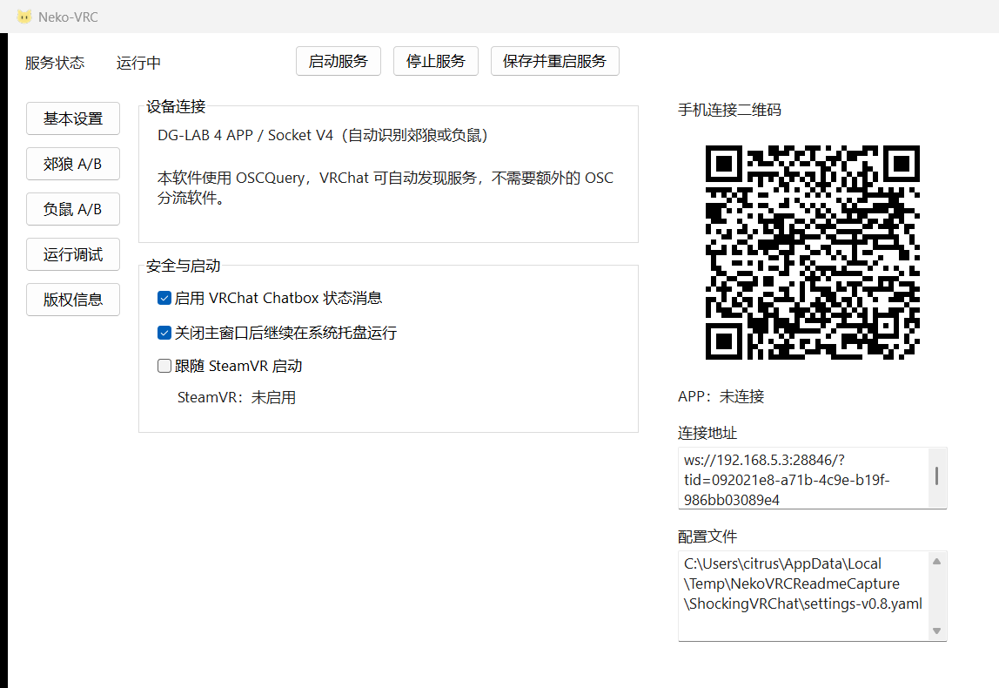
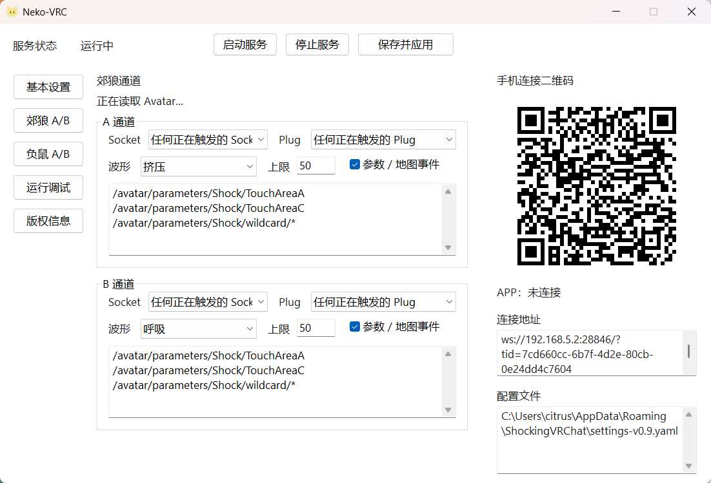
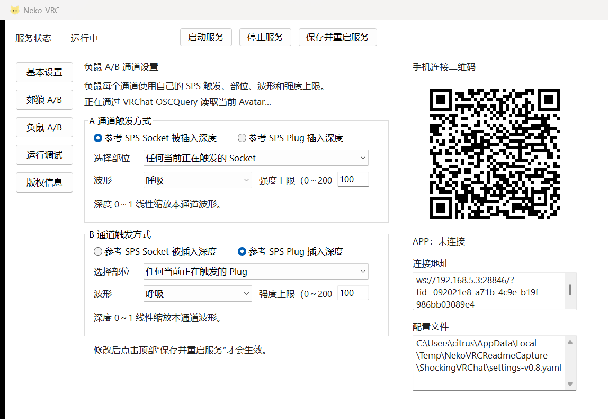
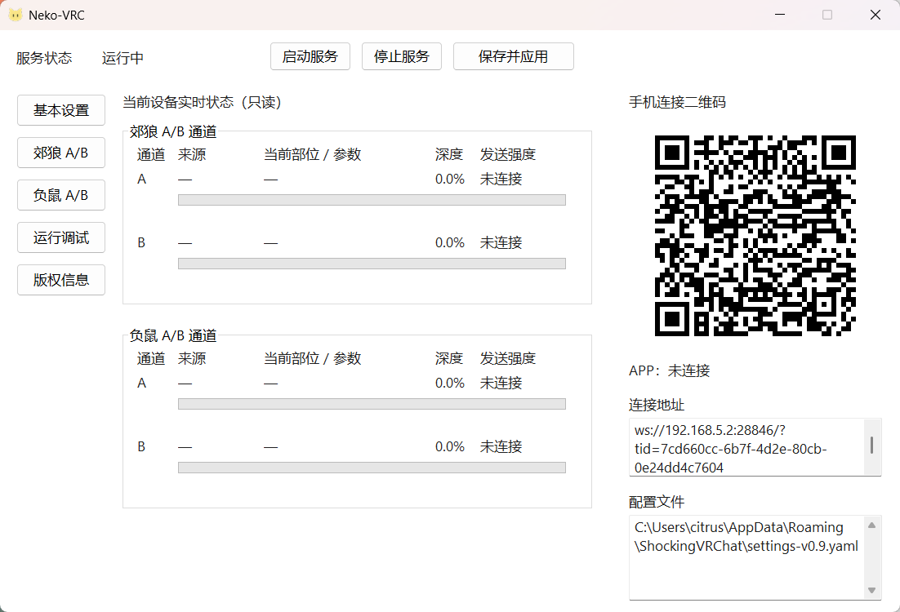
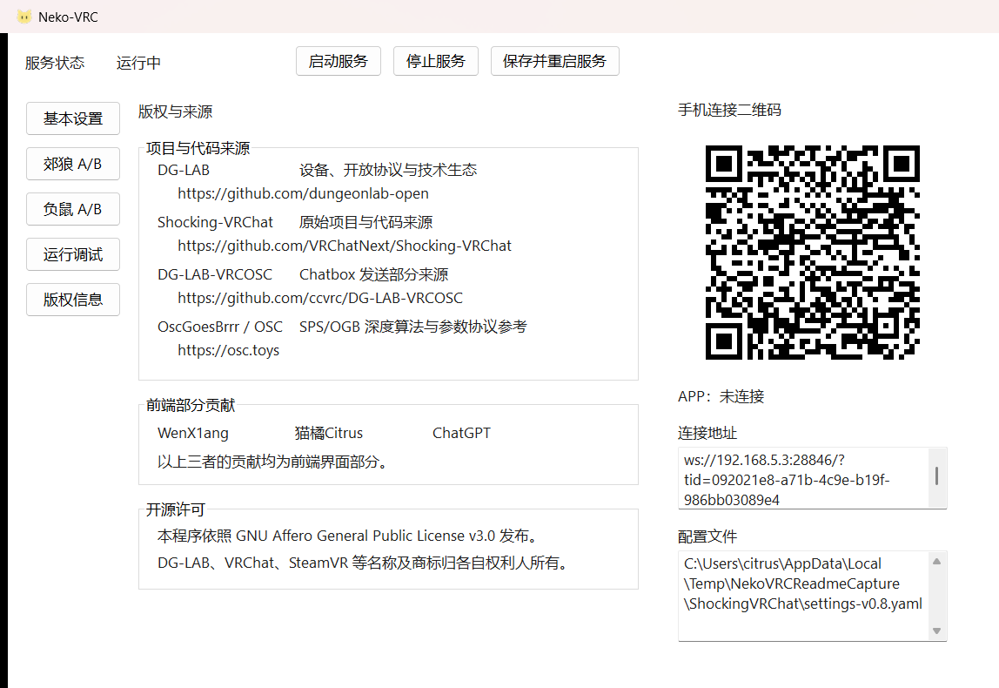

# Neko-VRC

| General | Coyote A/B | Opossum A/B | Runtime Debug | Copyright |
|---|---|---|---|---|
|  |  |  |  |  |

> This document is translated by AI.

Current version: **v2.0.1**. Installer and portable builds include WinUI 3, isolated waveform libraries, direct Bluetooth, four independent channel triggers and OSCQuery reading. The screenshots above show the older frontend.

A small tool that reads SPS/OGB penetration depth from VRChat OSC and controls either a Coyote DG-LAB 3.0 or an Opossum vibration controller.

> [!CAUTION]
> You must read and agree to the [Safety Precautions](doc/dglab/SafetyPrecautions.md) before using this tool!

Our VRChat Group: [ShockingVRC https://vrc.group/SHOCK.2911](https://vrc.group/SHOCK.2911)

## Usage

1. Go to [Project Releases](https://github.com/NekoCitrus/Neko-VRC/releases) to download the latest Neko-VRC build.
2. Extract the complete package and run `Neko-VRC.exe`. WinUI 3 follows the Windows light/dark theme and starts the backend automatically. Python, .NET and Windows App Runtime are bundled. Windows 11 supplies native rounded corners; Windows 10 uses the appearance supported by the OS.
3. Under **Coyote settings** and **Opossum settings**, configure Socket, Plug, extra parameters, waveform, and strength limit for each channel.
4. Edits apply and save automatically; continuous edits are coalesced about every 120 ms. Existing APP connections remain connected.
5. Select **App** or **Bluetooth direct** separately for each device kind. New profiles default to Bluetooth direct; saved choices are preserved. App mode uses the existing Socket QR connection. For direct mode, release the phone's Bluetooth connection, scan, select a host, and connect.
6. If background operation is enabled, closing the window hides it to the real Windows notification area. Use the tray menu to reopen or exit.

## Desktop UI

- **General:** Light / Dark / System appearance (applied and saved immediately without Save), Chatbox, background operation, and SteamVR auto-start. OSCQuery lets VRChat discover the service without extra OSC relay software.
- **Coyote settings:** independent A/B sources, waveform, and strength limit for each channel. The first choice, Pure (纯粹), is the new-profile default: a constant envelope follows the calculated ratio without preset modulation, retaining the required device pulse format and existing caps. Saved waveform choices are preserved.
- **Opossum settings:** independent A/B sources, official Opossum waveform, and strength limit for each channel.
- **Runtime Debug:** only calculated and device-reported strengths for Coyote/Opossum channels. Unchanged values are not repeated, and new entries automatically scroll to the bottom. Missing device feedback is labeled explicitly. Connection and battery status remain on device settings pages.
- **Copyright:** project and code sources, frontend contributors, and the open-source license.

The right-chevron **General → Waveform library** card opens a subpage with isolated Coyote and Opossum libraries. Click the parent title to return; there is no separate back button. Multi-select and drag items between the library and channel dropdown list; reorder the right-hand list by dragging. Edits save immediately without reconnecting. Selecting an item plays a scrolling amplitude histogram from exact 25 ms samples, with an independent preview pause control; it never drives hardware. Import ZIP archives, folders, or one/multiple `.pulse` files; duplicate content is skipped and reported. Switch a channel away from a waveform before removing it from the list.

The sample archive contains Coyote App waveforms, not Opossum waveforms. Opossum import currently accepts only explicitly device-tagged frame exchange files, not unverified official App export formats. See [waveform formats and limitations](doc/waveform-library.md). User waveforms are stored in `%APPDATA%\Neko-VRC\waveforms\library.json` and are excluded from releases.

Only one DG-LAB APP connection is accepted, but every supported Coyote and Opossum slot reported by that APP is controlled concurrently.

Each channel groups triggers into depth/zone, PCS/LMS fallback, and parameter/map columns. Its 0–200 cap slider and input are synchronized. A thicker blue level inside the native Slider track shows calculated strength, not instantaneous waveform amplitudes or hardware feedback; the A/B heading shows the source and calculated value. For multiple matching hosts it shows the maximum calculated level under their individual caps. Paused/disconnected output shows zero.

All editable settings apply/save automatically. Invalid text keeps the last valid configuration and displays an error; corrected input applies automatically. Cap/waveform edits preserve depth and trigger edits invalidate only affected inputs. Manual YAML changes still require reopening the application.

Each device kind has exactly one selected output route. App/Bluetooth mixed operation is supported; direct mode connects one host per kind. Saving channel settings preserves connections; changing route or address clears the old output and requires a new manual Bluetooth connection. Pause stops output and is latched until Resume. A lost radio link cannot guarantee delivery of a zero command; use the host's physical stop controls.

The window defaults to 940 × 640, with a DPI-scaled minimum of 880 × 640. One pause/play icon button matches the waveform preview controls and follows confirmed backend state; pause remains available during slow operations. It appears after status, parameter hint and Avatar name. There is no Save button. QR and connection actions stay in their original cards. Compact layout, native page transitions and navigation indicator animations are retained. Exiting hides the window immediately while valid settings flush and backend cleanup completes; close-to-tray behavior is preserved.

### Start with SteamVR

The **Start with SteamVR** checkbox uses an OpenVR application manifest. Start SteamVR before changing the option; it applies automatically. The manifest is stored under `%APPDATA%\Neko-VRC\steamvr\`.

This feature does not use Windows login startup and does not launch or poll for SteamVR. Failed changes restore the last successfully saved toggle state without automatic retries. A newly registered manifest may require a SteamVR restart; the toggle remains off until activation is confirmed, and you can enable it again after restarting SteamVR.

## Configuration location

```text
%APPDATA%\Neko-VRC\settings-v2.0.yaml
```

Each launch creates a timestamped file in `log\` beside `Neko-VRC.exe` (the project directory when running from source), rotating at 20 MB without overwriting prior runs. If unwritable, it falls back to `%APPDATA%\Neko-VRC\log\`. Main-module entries are branded `neko-vrc`. Files retain connection errors and diagnostics; unchanged strengths no longer generate periodic entries. Debug displays strengths only. Logs retain at least INFO, including calculated and device-reported strengths, ratios, sources, caps and measured stage timings—not physical actuation or phone-to-device end-to-end latency. Sent targets are never presented as confirmed feedback. Legacy configuration is read-only migrated from `%APPDATA%\ShockingVRChat` when needed. Runtime user logs are excluded from release ZIPs without deleting local copies.

While the service is running, an independent five-second heartbeat resolves VRChat's actual OSC destination through OSCQuery and sends the Boolean `/avatar/parameters/OGB_ENABLED=true`. It does not require Chatbox or a connected device. Shutdown stops the heartbeat without sending false, avoiding interference with other compatible apps.

Each connection card displays its measured communication time: App V4 prefers a request acknowledgment RTT from the past 30 seconds, otherwise WebSocket Ping/Pong RTT (also available for V3). BLE displays GATT write duration, explicitly labeled enqueue time when write acknowledgments are unsupported. Missing samples show no data. These measurements exclude the App-to-host Bluetooth link and physical actuation.

Direct Coyote V3 subscribes to notifications before zeroing/setting soft caps, and requests B1 strength feedback using nonzero sequence numbers. Waveforms continue while an acknowledgment is pending; zero/pause bypass the wait. SPS, PCS and map triggers do not require an App connection; legacy `sendwave` also uses the shared output router.

## Device control

Direct BLE has separate encoders for Coyote 2.0, Coyote 3.0, and Opossum V1. Coyote 3.0 rewrites BF soft caps on connection and cap updates. Opossum keeps B3 channel strength separate from B0 waveform amplitudes. Trigger ratios modulate waveforms, not configured caps. V2 only holds one XYZ group per 100ms, so V3 library frames are averaged and will not feel identical. Opossum screen B2 synchronization is skipped if negotiated MTU cannot hold the official packet; commands are never arbitrarily split. Hardware compatibility still requires real-device testing.

Official protocols: [Coyote V2](https://github.com/dungeonlab-open/dglab-bluetooth-protocol/blob/main/coyote/v2/README.md), [Coyote V3](https://github.com/dungeonlab-open/dglab-bluetooth-protocol/blob/main/coyote/v3/README.md), [Opossum](https://github.com/dungeonlab-open/dglab-bluetooth-protocol/blob/main/opossum-vibrate-controller/README.md).

Build on Windows with .NET 10 SDK, Windows SDK 10.0.26100.0 and Python dependencies from `requirements-build.txt`:

```powershell
powershell -ExecutionPolicy Bypass -File build-winui.ps1
```

Recommended: run `Neko-VRC-Setup-v2.0.1-win-x64.exe`. It installs per-user under `%LOCALAPPDATA%\Programs\Neko-VRC` without administrator access, with a Start menu entry and an optional desktop shortcut. Alternatively distribute the complete portable x64 directory `products/v2.0.1/Neko-VRC-WinUI-win-x64/`, or its `products/v2.0.1/Neko-VRC-WinUI-v2.0.1-win-x64.zip` archive. Final products are versioned under `products/`; backend intermediates remain under `build/`. Copying only the frontend EXE is not supported.

Build installers with [Inno Setup 6.7.3+](https://jrsoftware.org/isdl.php) and `powershell -ExecutionPolicy Bypass -File build-installer.ps1`. Use `-ISCC` for an explicit compiler path or `-SkipAppBuild` to reuse the current version. The script produces the setup EXE and `SHA256SUMS.txt` and tests installation, payload integrity, upgrade, installed UI and uninstall. Validation refuses to overwrite an existing installation. Setup never forcibly closes devices or applications. Configurations and waveform libraries in `%APPDATA%\Neko-VRC`, and runtime logs, are preserved on upgrade/uninstall. Disable SteamVR auto-launch before uninstalling. Binaries are not code-signed; Windows may show an unknown-publisher warning.

For source runs, build `desktop/NekoVRC.WinUI/NekoVRC.WinUI.csproj` with `-p:Platform=x64`, then launch `neko_vrc.py`. Native NavigationView, TitleBar and Toolkit settings cards follow the composition of [WSL Settings](https://github.com/microsoft/WSL/tree/master/src/windows/wslsettings) and [WinUI Gallery](https://github.com/microsoft/WinUI-Gallery). Navigation and content share a background, caption buttons are OS-rendered, and custom parameters are collapsed by default. See [third-party notices](THIRD-PARTY-NOTICES.txt).

The WPF project and `build-wpf.ps1` remain available. `--wpf-ui` explicitly selects the built WPF source frontend; `--legacy-ui` selects the old Win32 frontend. WinUI packages do not overwrite the existing WPF release directory.

In App mode, Coyote and Opossum share a DG-LAB 4 APP Socket V4 connection with independent host `slotId` values. Operations are routed according to each device kind's selected connection. Opossum waveforms are normalized to the OVC fixed prefix and four vibration-amplitude bytes. See the official [dglab-kit](https://github.com/dungeonlab-open/dglab-kit).

## Strength calculation

Each device channel has five independent source checkboxes. Only checked sources contribute to the maximum:

- **SPS Socket penetration:** estimates depth from the selected `OGB/Orf/<zone>` Root/Tip values using the OGB algorithm.
- **SPS Plug penetration:** reads `PenSelf/PenOthers` from the selected `OGB/Pen/<zone>`.
- **Extra parameters:** maps values through the legacy distance formula (default range `0..1`) and expires them after 0.5 seconds without an update.
- **PCS:** always maps `/avatar/parameters/pcs/contact/proximity` through distance when enabled, competing with other enabled sources for the maximum.
- **LMS:** uses `/avatar/parameters/lms/contact/proximity` as a distance fallback when the selected Plug depth is zero.

Socket, Plug, and extra parameters/map events default to enabled for all channels. PCS defaults to enabled for Coyote A/B and disabled for Opossum A/B; LMS defaults to disabled for Coyote A/B and enabled for Opossum A/B.

The maximum current value wins and linearly scales that device channel's waveform amplitude. There is no manual trigger-mode selector.

Socket and Plug can each target one named zone or **any currently active** zone. The application discovers VRChat's OSCQuery service and queries `/avatar` for the current Avatar and SPS parameter tree; `/avatar/change` only requests an immediate refresh.

Availability checks use readable numeric parameters. Zone lists/counts include only complete same-zone, same-owner Root/Tip pairs or direct depth signals, excluding Touch/Frot, incomplete pairs and unreadable nodes. Socket depth availability does not suppress enabled PCS input. Fresh OSCQuery values supplement live OSC, expire after 0.5 seconds, and cannot restore output while paused.

Waiting and availability hints appear once after the top service status, not under every channel. Missing depth suggests the available corresponding PCS/LMS fallback; if neither depth nor fallback exists, it reports no usable Socket/Plug parameters. Hints never change checkboxes automatically. Hover the question marks after PCS, LMS and parameter/map events for help.

Turning LMS off in-game, zeroing it or letting it expire does not clear other valid SPS readings. Catalog changes remove individual missing signals, not entire depth calculators. Cheese map events use a constant Pure envelope under each device's independent cap, returning to the selected SPS waveform when the event ends.

Your own Socket and Plug interactions are included automatically: the maximum of `Self` and `Others` wins. Enable `Avatar Self Interact` in VRChat and ensure the avatar outputs the corresponding OGB self-contact depth parameters. Attraction without a depth signal does not trigger output. See the [OGB setup guide](https://github.com/OscToys/osc.toys/blob/main/docs/20-getting-started.mdx).

When LMS is checked, all selected Plug depths (`PenSelf/PenOthers`) must be zero for LMS to contribute. Its value is mapped through the channel's distance range (default `0..1`). Any positive Plug depth blocks LMS. Coyote can also enable LMS manually.

When PCS is checked, it always contributes through the channel's distance range, regardless of Socket depth availability or zone selection. The maximum across enabled sources wins. Unchecking PCS removes its contribution.

PCS and LMS have independent checkboxes and expire after 0.5 seconds without updates. Disabling Socket or Plug preserves observations needed for fallback guards. Input changes invalidate only affected sources; cap/waveform changes preserve depth without reconnecting the APP.

## Configuration File Reference

The configuration format is YAML, version `v2.0`. Coyote and Opossum A/B settings are independent under `channels.dglab3.coyote` and `channels.dglab3.opossum`.

```yaml
version: v2.0
channels:
  version: v2.0
  dglab3:
    coyote:
      channel_a: {socket_zone: '*', plug_zone: '*', strength_limit: 100}
      channel_b: {socket_zone: '*', plug_zone: '*', strength_limit: 100}
    opossum:
      channel_a: {socket_zone: '*', plug_zone: '*', strength_limit: 100}
      channel_b: {socket_zone: '*', plug_zone: '*', strength_limit: 100}
settings:
  version: v2.0
  osc:
    listen_host: 127.0.0.1
    listen_port: 9001
  relay:
    enabled: false
    vrcft_port: 9011
    internal_port: 9021
```

## Model Parameter Configuration

- The Avatar must expose compatible SPS/OGB parameters.
- Socket paths start with `/avatar/parameters/OGB/Orf/`.
- Plug paths start with `/avatar/parameters/OGB/Pen/`.
- The application extracts zones from VRChat's live OSCQuery `/avatar` parameter tree. `*` means any currently active zone; a specific zone ID is also accepted. If the list is empty, verify that VRChat OSC is enabled and the Avatar exposes compatible SPS/OGB parameters.

## Advanced Configuration Reference

The following excerpt belongs inside the top-level `settings` section:

```yaml
SERVER_IP: null # When null, the program will attempt to automatically obtain the local IP. If incorrect, change null to the correct IP address (the one that the phone can access, usually the wired network or WiFi)
dglab3:
  coyote:
    channel_a: # Coyote channel A
      depth: {freq_ms: 10, waveform: 呼吸}
    channel_b: # Coyote channel B
      depth: {freq_ms: 10, waveform: 呼吸}
  opossum:
    channel_a: # Opossum channel A
      depth: {freq_ms: 10, waveform: 呼吸}
    channel_b: # Opossum channel B
      depth: {freq_ms: 10, waveform: 呼吸}
general: # General configuration
  run_in_background: true
  steamvr_auto_start: false # Prefer changing this in the desktop UI
  local_ip_detect:  # Server address for detecting local IP
    host: 223.5.5.5 # Default is AliDNS. If used outside mainland China, modify accordingly
    port: 80
log_level: INFO # Log level, can be changed to DEBUG for troubleshooting
osc: # OSC service configuration
  listen_host: 127.0.0.1 # If VRChat runs on another host, change to 0.0.0.0 and configure VRChat with the correct OSC startup command line parameters.
  listen_port: 9001
version: v0.8 # Configuration file version
web_server: # Web server configuration
  listen_host: 127.0.0.1 # If you need to open the web page for scanning from another host, change to 0.0.0.0
  listen_port: 8800
ws: # WebSocket service configuration
  listen_host: 0.0.0.0
  listen_port: 28846
  master_uuid: 6da2fd3b-a6e5-4af4-afc1-96bfd2e9e95c # Automatically generated randomly on first startup
```

### Chatbox and control API settings

Chatbox sends no text while waiting for a connection and clears its display when the last device disconnects. Each connected App or Bluetooth device gets one line with its effective A/B strength limits, without introductory text.

Missing options are added automatically to the unified v2.0 configuration:

```yaml
chatbox:
  enable: true
  osc_host: 127.0.0.1
  osc_port: 9000
  update_interval: 3.0
  set_avatar_parameter: true
api:
  control_enabled: false
  token: an automatically generated random token
```

The original map-integration endpoint `/api/v1/shock/<A|B|all>/<seconds>` accepts requests from VRChat `UnityPlayer` clients on the local machine or LAN and triggers Coyote and Opossum without enabling the general control API. Each device channel's "Parameters / Map Events" checkbox enables both extra OSC parameters and map events; saving applies it without reconnecting. Map events use that channel's waveform and effective strength limit, then resume the current Socket, Plug, or extra-parameter output when their duration ends. Raw-wave endpoints such as `/api/v1/sendwave/...` remain disabled by default; enable them only when required and provide the token through `?token=...` or the `X-Control-Token` header. Keep the token private and do not expose the web server to the public Internet.

`/api/v1/status` retains the original map-compatible shape, lists Coyote devices before Opossum, and also reports a connected Opossum when no Coyote is present. `attr.strength.A/B` contains each device's effective upper limit jointly imposed by the application setting and the device maximum.

## Development and packaging

```powershell
.\.venv\Scripts\Activate.ps1
python -m pip install -r requirements-build.txt
python -m unittest discover -v
powershell -ExecutionPolicy Bypass -File build-winui.ps1
```

The script builds a self-contained WinUI 3 frontend and a console-free Python backend, producing `products\v2.0.1\Neko-VRC-WinUI-v2.0.1-win-x64.zip`. Isolated integration checks cover pages, bindings and both exit routes. Extract the whole directory and run `Neko-VRC.exe`, keeping its `backend` subdirectory. Configuration is stored under `%APPDATA%\Neko-VRC\`, not in the release directory. WPF fallback builds also use `products\v2.0.1\`, with `WPF` in the artifact names.

## FAQ

### Is there an escape route?

- On a Coyote, press either shoulder button to set both channels to 0. For an Opossum, stop output or disconnect the device in DG-LAB APP.
- When the program detects that the channel strength is manually set to 0, it will no longer automatically follow the strength limit.
- To restore, manually click the "+" button on the phone to increase the channel strength by 1, thereby resuming automatic following.

### How should I set the strength limit?

- It is recommended to adjust through the controlled settings in the Coyote APP. The program will follow these settings.
- Use the corresponding **Coyote A/B** or **Opossum A/B** page. A Coyote value is additionally capped by that slot's `intensityMax`; an Opossum value is independent.
- To ensure the strength follows automatically, make sure that the initial strength limit value (minimum value) of both channels in the Coyote APP's controlled settings menu is greater than or equal to 1.

### How can I use one SPS zone to trigger two channels simultaneously?

- On the corresponding **Coyote A/B** or **Opossum A/B** page, select the same SPS trigger type and zone for A and B, then save and restart the service.

### The waveform is output in the console, but there's no strength or the strength significantly decreases.

- Try pressing a button to set the Coyote's strength to 0, then manually click the screen to increase it by 1 to resume normal mode.

### The program doesn't seem to receive OSC data.

1. **If you have face tracking**, check the launch command line parameters of VRChat in Steam to see if there is a configuration similar to `--osc=9000:127.0.0.1:9001`. If so, modify the `osc` `listen_port` value in the advanced configuration file to the value after the last colon, such as 9001.
2. In the Action Menu, select Options > OSC > Reset Config to reset the OSC configuration.
3. If it was working normally before but suddenly stopped, restarting the computer might solve the problem, which seems to be a VRChat bug.

### Why is the strength always at the maximum available value?

- Coyote uses the lower of its reported `intensityMax` and the matching limit on **Coyote A/B**; Opossum uses its matching independent limit on **Opossum A/B**.
- SPS penetration depth `0..1` linearly scales waveform amplitude. Pure sets each amplitude sample to the calculated ratio × 100 without preset modulation. The device strength cap is independent of this real-time ratio.

### The APP cannot connect/connection times out when scanning the QR code.

1. Make sure the phone and computer are on the same network, for example, the phone cannot use mobile data.
2. Check the connection address below the QR code, such as `ws://192.168.1.2:28846/?tid=...`. The IP must be reachable from the phone and must not be `127.0.0.1`.
3. If the IP is incorrect, fill in the correct IP address in the advanced configuration file under `SERVER_IP:` and restart the program to try again.
4. Check if the Windows firewall allows this program to access the network (accept incoming connections).
5. Current QR codes use the official DG-LAB Socket V4 format. If the status says that the V4 app is connected but waiting for a device, scanning and networking are working; connect a Coyote or Opossum over Bluetooth in the app.

### How to inherit configuration files after program updates?

- The first v0.8 run migrates v0.7 and older files while retaining them. Shared trigger settings initialize both device-specific configurations.

### OSC can receive other parameters but not the model's parameters.

- Confirm that the Avatar exposes `/avatar/parameters/OGB/Orf/...` or `/avatar/parameters/OGB/Pen/...`.
- If the Avatar was just modified, reset its OSC configuration from Action Menu > Options > OSC > Reset Config.

## Credits

Thanks to [DG-LAB](https://github.com/dungeonlab-open) for the devices, open protocols, and technical ecosystem.

The original project and code come from [Shocking-VRChat](https://github.com/VRChatNext/Shocking-VRChat). The Chatbox sending implementation comes from [DG-LAB-VRCOSC](https://github.com/ccvrc/DG-LAB-VRCOSC).

The frontend UI was contributed by WenX1ang, 猫橘Citrus, and ChatGPT.

-----

## Safety Precautions:

**To ensure your healthy enjoyment of the product, please make sure to read and understand all the contents of this safety notice before use.**  
**Improper use of this product may cause harm to you or others, and you will be responsible for any resulting liability.**

Thank you for choosing the DG-LAB series of products. User safety is always our top priority.  
This product is a sex toy, make sure to use in a **safe, sober, voluntary** basis. And please place this product in a location that is inaccessible to minors.

This safety notice takes approximately **2 minutes** to read.

### **This product is strictly forbidden to be used by the following people:**

1. **People with pacemakers or electronic/metal implants in their bodies** (which may affect the normal function of pacemakers or implants).
2. **Patients with epilepsy, asthma, heart disease, thrombosis, and other cardiovascular and cerebrovascular diseases** (sensory stimulation may induce or exacerbate symptoms).
3. **Patients with sensitive skin, eczema, and other skin diseases** (may aggravate skin disease symptoms).
4. **Patients with bleeding tendency diseases** (electrical stimulation may cause local capillary dilation and potential bleeding).
5. Minors, pregnant women, people with abnormal perception and no expressive ability.
6. People with limb movement disorders and other people **who cannot operate the product in a timely manner** (may not be able to stop output when feeling uncomfortable).
7. Other people who are undergoing treatment or are physically uncomfortable.

### **The following areas are strictly prohibited from using this product:**

1. The electrodes must not be placed on the chest. **It is absolutely forbidden to place the two electrodes in front and back, left and right of the heart projection area** or any position where the current may pass through the heart.
2. The electrodes must not be placed **near the head, face, eyes, mouth, and neck.**
3. The electrodes must not be placed on **damaged or swollen skin, joint sprains and bruises, muscle strains, inflammation/infection lesions, or near wounds that have not completely healed.**

### **Other precautions:**

1. **It is strictly forbidden to use the same part for more than 30 minutes continuously. **Long-term use may cause local redness, swelling, decreased sensation, and other injuries.
2. Do not move the electrode in the output state. **When moving the electrode or replacing the electrode, you must stop the output first** to avoid changes in contact area causing stinging or burns.
3. It is strictly prohibited to use this product in dangerous situations such as driving or operating the machine to **avoid losing control due to pulse effects.**
4. It is strictly forbidden to insert electrode wires into places other than the mainframe wire plug hole (such as power sockets).
5. It is strictly forbidden to use in places with flammable and explosive substances.
6. **Do not use multiple devices simultaneously.**
7. Do not disassemble or repair the product host without authorization, which may cause malfunctions or unexpected outputs.
8. Do not use in humid environments such as bathrooms.
9. During use, **avoid allowing the two electrodes to come into contact and create a short circuit. **This may result in reduced effectiveness, discomfort or burns at the contact site, or damage to the device.
10. During electrode use, it is essential for them to be **in close and full contact with the skin. **Inadequate contact may result in stinging or burns. If the contact area between the electrode and the skin is too large, it may lead to weak electrical sensation.
11. The product contains lithium batteries. It is prohibited to disassemble, reassemble, squeeze or put them into fire. **If the product malfunctions or overheats abnormally, **please do not continue to use it.

### **Important usage tips:**

1. Due to variations in the tolerance of different body parts to electrical currents and the potential for some materials in the electrodes to cause allergic reactions in a small number of users, **it is recommended to conduct a 10-minute trial when using this product on a new area for the first time or with a new set of electrodes. **After the trial, take a break and ensure there are no adverse reactions at the application site before continuing use.
2. Due to the physiological characteristics of the human body, the sensitivity to sustained pulse stimulation will gradually decrease during use. Therefore, it may be necessary to gradually increase the intensity during use to maintain a relatively stable physical sensation stimulation intensity.  
This may result in **real stimulation intensity gradually exceeding the acceptable range but not being felt after using the same part of the body for a long time, **resulting in damage.  
Although the maximum output of this product strictly complies with safety standards (r.m.s < 50ma, 500Ω), long-term use may still cause harm to your body.Therefore, **strictly adhere to the duration limits during use. **After continuous use in the same area for **30 minutes,** take a break to allow sensitivity to return to normal levels.
3. Continuous and uninterrupted high-frequency stimulation may cause rapid adaptation at the application site. It is recommended to use waveforms with **changing frequencies and intermittent rests **for a better user experience. Each segment of waveform stimulation can be set between 1 to 10 seconds, with a rest period of 1 to 10 seconds being advisable.
